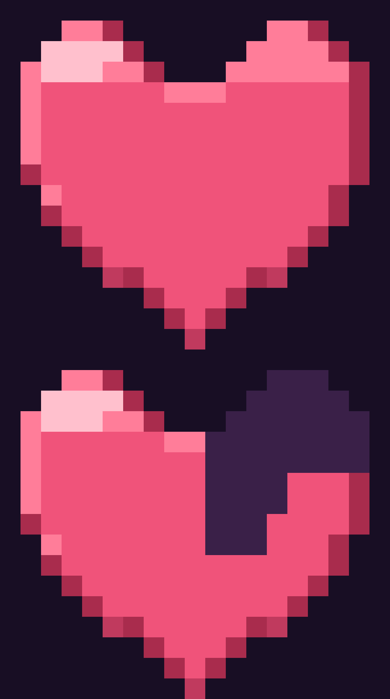

# SAMINA ♥ A LOVE APOLOGY GAME

Маленькая романтическая игра-открытка в пиксельном стиле: три вопроса, пять испытаний,
восемь фрагментов сердца и финал — письмо, которое хочется сказать лично.

Сделано на чистом HTML + CSS + JavaScript (ES-модули), без фреймворков, без сборки,
без серверов и без единого внешнего запроса. Всё работает офлайн, прямо из папки.



---

## Быстрый запуск

Игре нужен **локальный сервер**: она собрана на ES-модулях, а браузеры не разрешают
загружать модули по `file://`.

```bash
# в папке с игрой
python3 -m http.server 8080
# открыть http://localhost:8080/
```

Есть Node? Подойдёт `npx serve .` или `npx http-server -p 8080`. Любой статический сервер.

## Как выложить на GitHub Pages

1. Создай репозиторий и залей туда **содержимое** этой папки (`index.html` должен лежать в корне).
2. Settings → Pages → Source: **Deploy from a branch**, ветка `main`, папка `/ (root)`.
3. Через минуту игра будет доступна по адресу `https://<логин>.github.io/<репозиторий>/`.

Файл `.nojekyll` уже лежит в архиве — дополнительно ничего настраивать не нужно.
Все пути относительные (`./assets/...`, `./js/...`), поэтому игра одинаково работает
и в корне домена, и в подпапке репозитория. Регистр в именах файлов важен:
на Linux-хостинге GitHub Pages `Image.PNG` и `image.png` — разные файлы.

## Куда положить фотографии

Три фото кладутся в `assets/photos/` с именами **ровно такими**:

```
assets/photos/image.png
assets/photos/image1.png
assets/photos/image2.png
```

Пропорции любые: фото вписывается целиком (`object-fit: contain`), не растягивается
и не обрезается. Никаких других имён (`image.png1`, `image.1png` и т. п.) игра не ищет.

**В этом архиве файлов фото нет** (их не было в рабочей папке) — создавать фальшивые
картинки нельзя, поэтому в `assets/photos/` лежит только `README.txt`. Пока файлов нет,
на месте фото показывается аккуратная рамка с точным путём — игра проходится до конца
и без снимков. Достаточно положить три файла с нужными именами и обновить страницу.

## Палитра

Три цвета, на которых держится весь интерфейс:

| Роль | Цвет | Где |
|---|---|---|
| Основной фон (70–80%) | `#E3D8C8` | фон страницы, полотна игр, небо, панели-подложки |
| Второй цвет (15–25%) | `#4A3B32` | кнопки, заголовки, рамки, иконки, дорога, земля, силуэты |
| Акцент (совсем немного) | `#171514` | контуры, тёмные детали, тень под кнопкой |

Тёплый бежевый держит интерфейс, коричневый — кнопки и графику, тёмный — только линии
и мелкие акценты. Роза, сердечки, мишки, фото, салют и персонажи в играх сохраняют
собственные цвета — в бежевый не перекрашивались.

## Управление

| Действие | Мышь / палец | Клавиатура |
|---|---|---|
| Ответ, выстрел, прыжок, старт | клик / тап | Space (в играх) |
| Лук | тап по мишени | — |
| Машинки | веди пальцем по дороге | ← → или A / D |
| Стикман | тап = прыжок (двойной тоже) | Space |
| Сердечки | веди корзину | ← → |
| Память | тап по карточкам | — |

Кнопки в правом верхнем углу: **звук** (вкл/выкл, состояние запоминается) и
**сброс** (с подтверждением — стирает прогресс).

## Что внутри

```
index.html          каркас: HUD, сцена, вспышки, модальные окна
styles.css          все стили (27 секций), адаптив, reduced-motion
js/
  main.js           маршрутизация сцен, порядок финала
  state.js          единственный источник правды + localStorage
  core/             dom · device (качество эффектов) · loop (один rAF) · audio (Web Audio)
  data/texts.js     тексты финала и открытки
  scenes/           15 сцен: интро, вопросы, переход, 7 финальных
  games/            оболочка мини-игр + лук, машинки, стикман, сердечки, память
  ui/               HUD, сердца, награда, потеря жизни, повтор, экраны, мишки
assets/
  fonts/            Inter (текст) + Manrope (заголовки), локальные woff2
  music/daisy.mp3   фоновая музыка (CC0)
  photos/           сюда фото (см. выше)
  icons/ images/    фавикон и превью сердца
```

## Как это устроено

- **Прогресс сохраняется** в `localStorage` (ключ `samina.love.save.v1`): фрагменты,
  жизни, отвеченные вопросы, пройденные игры, mute, текущая сцена. Перезагрузка
  возвращает туда, где остановился. Кнопка сброса в HUD чистит всё.
- **Жизни:** 5 сердец в стиле Minecraft. Неверный ответ — красная вспышка, звук
  и сердце разлетается на пиксели. На нуле — экран повтора: жизни восстанавливаются,
  этап начинается заново, собранные фрагменты остаются.
- **Фрагменты:** 8 штук, 3 за вопросы и 5 за испытания, каждый выдаётся один раз.
- **Финал запускается сам** после победы в последнем испытании и идёт по порядку
  без единой кнопки: сборка сердца → «Samina i love you!<3» → текст извинения →
  чёрно-белое разбитое сердце с проявляющимися глазами → цифровой дождь →
  красная роза → салют → три фото по очереди → открытка с мишками и письмом.
  Переходы держит один таймер на сцену: он отменяется при уходе со сцены, поэтому
  анимации не накладываются и не срабатывают дважды. Весь финал занимает ~47 секунд,
  в открытке по-прежнему можно листать письмо.
- **Звук:** все эффекты синтезируются на лету через Web Audio API (ноль файлов),
  музыка — один локальный mp3, стартует только после первого касания.
- **Производительность:** один общий `requestAnimationFrame`, циклы останавливаются
  на неактивной сцене и скрытой вкладке, частицы в пулах, лимиты dpr на тяжёлых
  сценах, автоматическое упрощение на слабых устройствах и при `prefers-reduced-motion`.

## Сложность испытаний

Все пять игр остались на месте, но настроены мягко — чтобы проходились с первого-второго
раза и на телефоне:

| Игра | Что упрощено |
|---|---|
| Лук | мишень крупнее (радиус 30 px вместо 22), радиус попадания 30 px, нужно **2** попадания вместо 3 |
| Машинки | дистанция 2300 вместо 3200, скорость 104→138 px/с вместо 132→178, пауза между препятствиями 0.95–1.5 с, меньше конусов |
| Стикман | дистанция 2150 вместо 2900, скорость 98 px/с, полёт прыжка дольше (g 900), ямы 20–25 px и реже препятствия |
| Сердечки | корзина 46 px вместо 30, падение 34–54 px/с, нужно **8** сердечек вместо 12, камней меньше |
| Память | 6 карточек / 3 пары, карточки открываются на 1.6 с перед стартом, показ пары — 1.15 с |

Победа в любом испытании, как и раньше, даёт ровно один фрагмент сердца — всего их 8.

## Совместимость

Современные Chrome, Edge, Safari, Firefox (ES-модули, Canvas 2D, Web Audio, `env()`).
Проверено на разрешениях от 320×568 до 1440×900 и в ландшафте телефона;
работает и в подпапке (GitHub Pages).

## Документы

- [`TEST_REPORT.md`](./TEST_REPORT.md) — что и как реально тестировалось, с цифрами и честным списком непроверенного.
- [`ASSETS_LICENSES.md`](./ASSETS_LICENSES.md) — лицензии на шрифты, музыку и графику.
